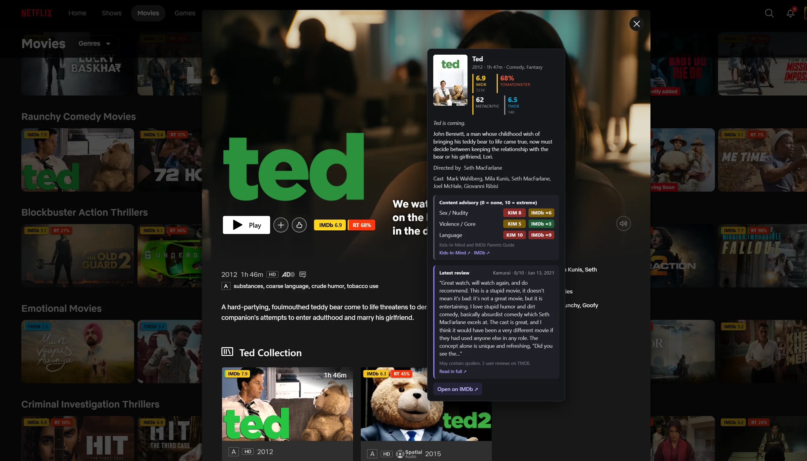

# StreamRating

A browser extension (Firefox and Chrome) that shows IMDb, OMDb, TMDB and Rotten Tomatoes ratings on Netflix and
YouTube thumbnails, with the latest user review and a content advisory (sex/nudity, violence/gore, language).

**Website:** https://manish-404.github.io/StreamRating/
**Firefox add-on:** https://addons.mozilla.org/en-US/firefox/addon/streamrating/


<table>
  <tr>
    <td><a href="docs/screenshots/netflix-browse.webp"></a></td>
    <td><a href="docs/screenshots/netflix-detail.png"></a></td>
    <td><a href="docs/screenshots/content-advisory.webp"></a></td>
    <td><a href="docs/screenshots/settings.png"></a></td>
  </tr>
</table>

## Features

- Ratings badges on Netflix thumbnails, the home-page billboard, "More Like This" tiles, title pages and individual
  episodes. Episodes show their own IMDb score, and hovering one opens the episode's air date, runtime, plot and
  scores.
- Ratings on YouTube for films sold on YouTube Movies & TV, and for videos whose title names a film and says
  "Movie", "Film", "Trailer" or "Teaser" (for example "Pushpa 2 Full Movie Hindi Dubbed" or "Dune: Part Two |
  Official Trailer"). Also under the title on the watch page. Other videos get no badge.
- Hover card with IMDb, Rotten Tomatoes, Metacritic and TMDB scores, the synopsis, cast and the latest user review
  (author, their score, date and an excerpt, with spoilers flagged and a link to read it in full).
  The card scrolls when it is taller than the window.
- Content advisory in the hover card: sex/nudity, violence/gore and language scores out of 10, from Kids-In-Mind and
  IMDb's Parents Guide, for whichever of them has the title.
- Switch Netflix and YouTube on or off in Settings.
- Your API keys stay in this browser only.


## Content advisory

Open a hover card and StreamRating scores the title for **sex and nudity**, **violence and gore** and **language**,
each from 0 (none) to 10 (extreme), from two sources:

- **[Kids-In-Mind](https://kids-in-mind.com)** gives its own 0 to 10 score for each category, for films it has reviewed.
  This is the more precise source.
- **IMDb's Parents Guide** rates each category None, Mild, Moderate or Severe. These are shown as 0, 3, 6 or 9 with a
  `≈`, because they are rougher than Kids-In-Mind's numbers.

Scores are coloured green (3 or less), amber (4 to 6) or red (7 or more). If only one source has the title you see
just that one, and the card links to the full page on each. For *Ted* (2012), Kids-In-Mind gives sex/nudity 8,
violence/gore 5 and language 10, and IMDb comes out at about 6, 3 and 9.

[](docs/screenshots/content-advisory.webp)

## Planned

These have tabs in the options page but are **not built yet**: watch history, a watchlist, "For You" recommendations,
and backup to Google Drive or a local folder. More streaming sites (Hotstar, Prime Video, Zee5, Sony Liv) will follow
as their adapters are written.

## Setup

The extension looks ratings up through two free APIs, so you need a key for each:

- TMDB: https://www.themoviedb.org/settings/api
- OMDb (free keys allow 1,000 requests a day): https://www.omdbapi.com/apikey.aspx

Paste them in the extension's Settings tab and press **Save and test keys**.

## Development

```
npm install
npm run dev            # Chrome, with hot reload
npm run dev:firefox
npm test
npm run typecheck
npm run build          # Chrome build in .output/chrome-mv3
npm run build:firefox  # Firefox build in .output/firefox-mv2
npm run zip:firefox
```

Built with [WXT](https://wxt.dev), TypeScript, Preact and Dexie.

## Privacy

Titles you browse are sent to TMDB and OMDb to look up ratings, and to Kids-In-Mind and IMDb to look up the content
advisory when you open a hover card. Nothing else leaves the browser. Full details are in the [privacy policy](https://manish-404.github.io/StreamRating/privacy.html).
