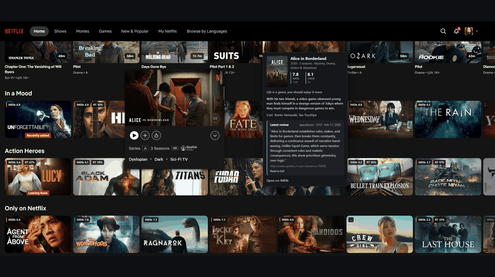
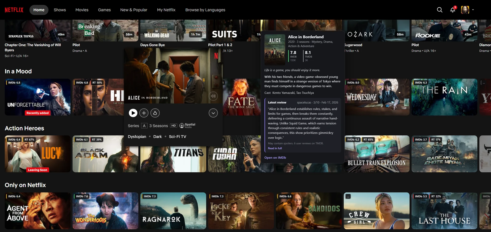
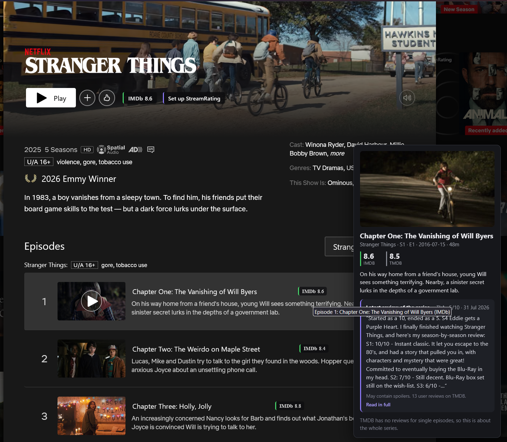
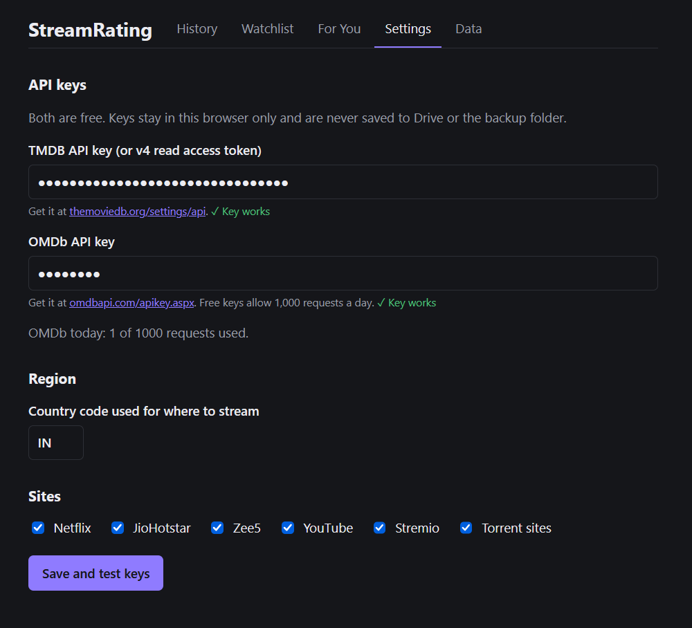

# StreamRating

A browser extension (Firefox and Chrome) that shows IMDb, OMDb, TMDB and Rotten Tomatoes ratings on Netflix and
YouTube thumbnails, with review summaries, watch history and recommendations.

**Website:** https://manish-404.github.io/StreamRating/
**Firefox add-on:** https://addons.mozilla.org/en-US/firefox/addon/streamrating/



<table>
  <tr>
    <td><a href="docs/screenshots/netflix-browse.webp"></a></td>
    <td><a href="docs/screenshots/netflix-detail.png"></a></td>
    <td><a href="docs/screenshots/settings.png"></a></td>
  </tr>
</table>

## Features

- Ratings badges on Netflix thumbnails, title pages and individual episodes.
- Ratings on YouTube for films sold on YouTube Movies & TV, and for videos whose title names a film and says
  "Movie", "Film", "Trailer" or "Teaser" (for example "Pushpa 2 Full Movie Hindi Dubbed" or "Dune: Part Two |
  Official Trailer"). Also under the title on the watch page. Other videos get no badge.
- Hover card with the ratings, synopsis and a summary of the latest review.
- Watch history, watchlist and a "For You" recommendations tab.
- Your API keys stay in your browser and are never saved to Drive or the backup folder.


## Setup

The extension looks ratings up through two free APIs, so you need a key for each:

- TMDB: https://www.themoviedb.org/settings/api
- OMDb (free keys allow 1,000 requests a day): https://www.omdbapi.com/apikey.aspx

Paste them in the extension's Settings tab and press **Save and test keys**.

## Development

```
npm install
npm run dev            # Chrome, with hot reload
npm run dev:firefox
npm test
npm run typecheck
npm run build          # Chrome build in .output/chrome-mv3
npm run build:firefox  # Firefox build in .output/firefox-mv2
npm run zip:firefox
```

Built with [WXT](https://wxt.dev), TypeScript, Preact and Dexie.

## Privacy

Titles you browse are sent to TMDB and OMDb to look up ratings. Nothing else leaves the browser. Full details are in the [privacy policy](https://manish-404.github.io/StreamRating/privacy.html).
